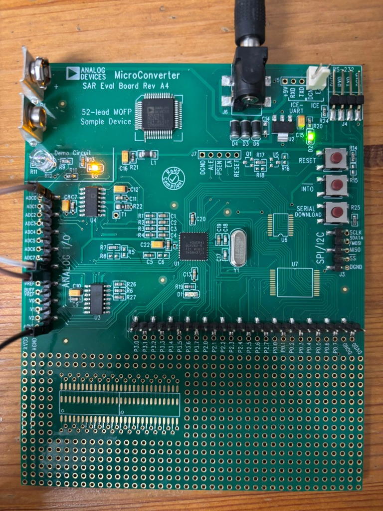
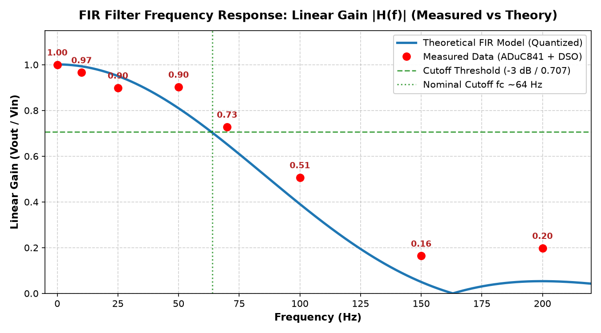
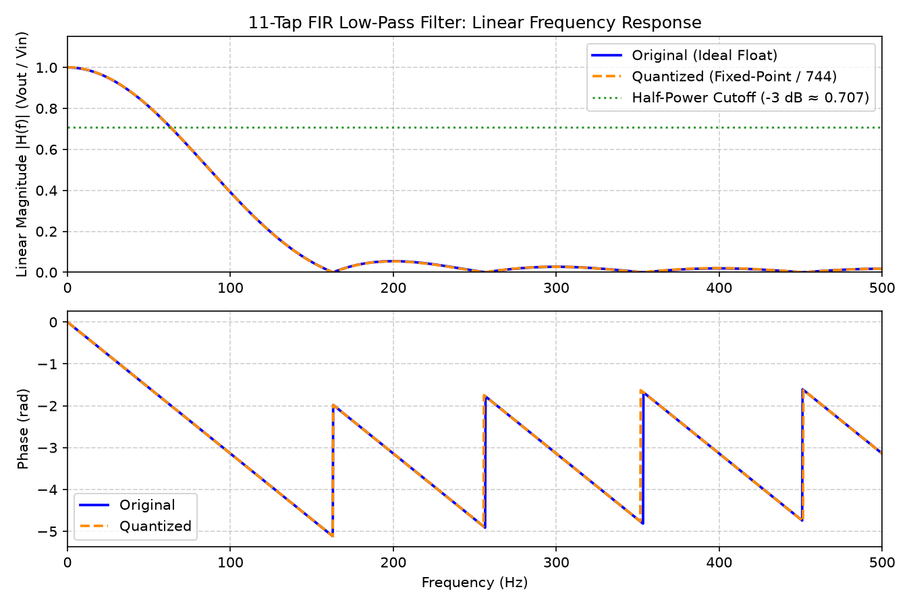
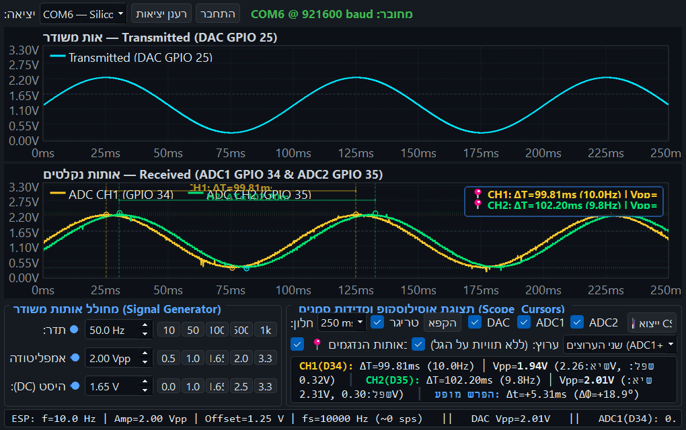
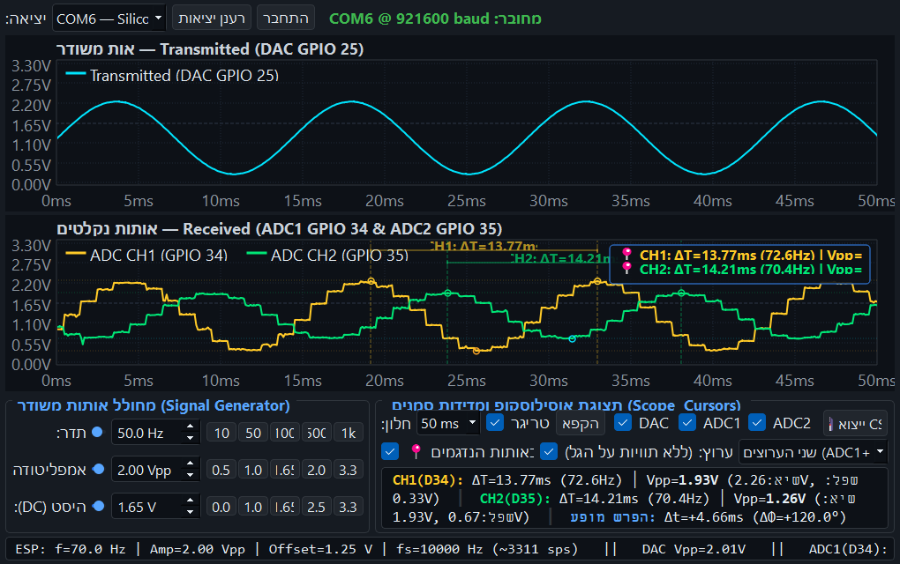
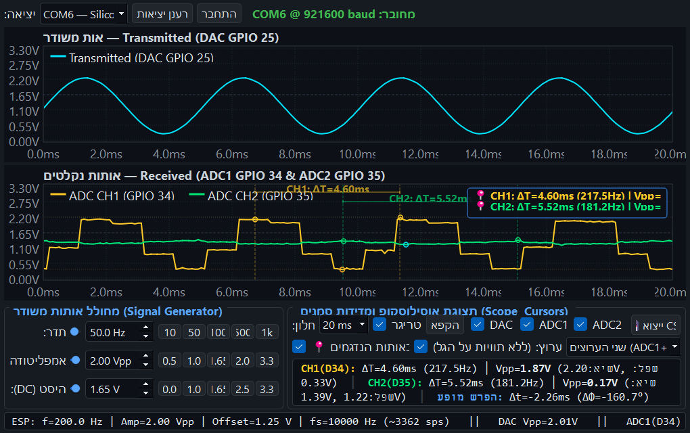

# מסנן ספרתי בזמן אמת (FIR Filter) על מיקרו-בקר ADuC841 (ארכיטקטורת 8051)

[-orange.svg)](https://www.analog.com/en/products/aduc841.html)
[](#-ארכיטקטורת-המערכת)
[](#-מודל-מתמטי-וחשבון-נקודה-קבועה-fixed-point-dsp)
[](#-אימות-ניסיוני-וממצאי-מעבדה)
[](LICENSE)

**[English](README.md) • [עברית](README.he.md)**

מימוש Bare-Metal בשפת C של **מסנן מעביר נמוכים ספרתי מסוג FIR (Finite Impulse Response) בזמן אמת**, בעל 11 מקדמים, הרץ ישירות על גבי מיקרו-בקר **Analog Devices ADuC841** (ליבת 8051 בעלת מחזור שעון יחיד לפקודה).

המערכת דוגמת אות אנלוגי בכניסה באמצעות טריגר חומרה מטיימר ($F_s = 1000\text{ Hz}$), מבצעת קונבולוציה בחשבון נקודה קבועה (Fixed-Point) באמצעות חוצץ מעגלי ב-$O(1)$ בזיכרון הנתונים הפנימי המהיר (`idata`), ומשחזרת בו-זמנית שני אותות אנלוגיים דרך צמד ממירי DAC של 12 ביט להשוואה חיה באוסילוסקופ בין האות המקורי לאות המסונן.

<div align="center">
  
  <p><em>מערך החומרה: כרטיס הפיתוח Analog Devices ADuC841 MicroConverter SAR Evaluation Board (Rev A4) המריץ את קושחת ה-FIR בזמן אמת</em></p>
</div>

---

## 🚀 דגשים הנדסיים מרכזיים (Embedded / DSP Highlights)

- **תזמון דטרמיניסטי בזמן אמת (Hard Real-Time):** טיימר 2 ב-Auto-reload של 16 ביט (`RCAP2 = 0xD4CC`) מפעיל ישירות את המרת ה-SAR ADC בדיוק בכל $1.0\text{ ms}$ ($1.0\text{ kHz}$), ומבטל לחלוטין ריצוד (Jitter) שמקורו בתוכנה.
- **ארכיטקטורת פסיקות רזה (Lean ISR):** פסיקת סיום המרת ADC (`interrupt 6`) מבצעת רק קריאה מהירה של רגיסטר הנתונים (`ADCDATA`), שמירת המדגם והדלקת דגל אירוע, כאשר כל חישובי ה-DSP מבוצעים בלולאה הראשית לשמירה על שיהוי פסיקה מינימלי.
- **ניהול ומיפוי זיכרון יעיל בארכיטקטורת 8051:**
  - **חוצץ מעגלי (Circular Buffer):** מוקצה במפורש בזיכרון **`idata`** (RAM פנימי מהיר ללא מחזורי המתנה של `xdata`) בסיבוכיות עדכון ושליפה של $O(1)$.
  - **מקדמי המסנן:** מאוחסנים בזיכרון התוכנית/פלאש (**`code`**) כקבועי `signed char`, לחיסכון קריטי בזיכרון ה-RAM המוגבל של המיקרו-בקר.
- **חשבון נקודה קבועה (Fixed-Point DSP):** כל החישובים מנורמלים באמצעות פקטור שלם (`SCALING_FACTOR = 744`) ואוגר צבירה 32 ביט (`long int sum`), מה שמבטל לחלוטין את הצורך באמולציית נקודה צפה (Floating-Point) האיטית במעבדי 8-ביט.
- **שחזור אות בממירי DAC כפולים:**
  - **`DAC0`:** הוצאה ישירה של אות הכניסה הגולמי (Raw Pass-Through) כערוץ ייחוס סנכרוני.
  - **`DAC1`:** הוצאת האות המסונן בזמן אמת, כולל מנגנון הגנה מפני Underflow ואיפוס ערכים שליליים (`if (filtered < 0) filtered = 0;`).
- **אימות ואפיון חומרה מלא:** אפיון מלא מ-$0\text{ Hz}$ ועד $200\text{ Hz}$ באמצעות סביבת בדיקה ואוסילוסקופ ספרתי חי (ESP32 DSO @ 10 kSPS).

---

## 📐 ארכיטקטורת המערכת

### תרשים זרימת האות (Signal Pipeline)

```mermaid
flowchart LR
    A["אות אנלוגי בכניסה<br>2.00 Vpp, Offset 1.25V"] -->|טריגר חומרה טיימר 2| B["12-bit SAR ADC<br>Fs = 1.0 kHz"]
    B -->|פסיקת ADC ISR| C["חוצץ מעגלי<br>(זיכרון idata)"]
    C -->|קונבולוציה Σ(h·x)| D["מנוע FIR בנקודה קבועה<br>11 Taps, פקטור 744"]
    B -->|מעבר ישיר| E["DAC0: אות גולמי<br>(ערוץ 1 - צהוב)"]
    D -->|מנגנון Clamping| F["DAC1: אות מסונן<br>(ערוץ 2 - ירוק)"]
    E --> G["אוסילוסקופ ספרתי (DSO)"]
    F --> G
```

### המודל המתמטי

המסנן מממש משוואת הפרשים של מסנן FIR סימטרי בעל מופע ליניארי (Linear Phase):

$$y[n] = \frac{1}{\text{SCALING\_FACTOR}} \sum_{m=0}^{10} h[m] \cdot x[n-m]$$

* **מקדמי המסנן ($h[m]$):** `{0, 30, 64, 96, 119, 127, 119, 96, 64, 30, 0}`
* **נרמול:** סכום המקדמים $\sum h[m] = 745 \approx 744$ (`SCALING_FACTOR = 744`), המבטיח הגבר DC מדויק של 1.00 ($0\text{ dB}$).
* **שיהוי קבוצתי קבוע (Group Delay):** $\tau = \frac{N-1}{2} \cdot T_s = 5 \times 1.0\text{ ms} = 5.0\text{ ms}$.
* **תדר קיטעון נומינלי ($-3\text{ dB}$ Cutoff):** $f_{-3\text{dB}} \approx 63.6\text{ Hz}$.

---

## 🔬 אימות ניסיוני וממצאי מעבדה

### עקומות תגובת תדר ואימות חומרה (Linear Magnitude & Phase)

התגובה הפיזית של החומרה תואמת במדויק את המודל התיאורטי בכל משטרי הפעולה ($0-200\text{ Hz}$):

| אימות חומרה אמפירי: מדידות אוסילוסקופ מול תיאוריה | מודל תכנון: אידיאלי (Float) מול קוונטיזציה (Fixed-Point) |
| :---: | :---: |
|  |  |
| **נקודות המדידה האמפיריות מהאוסילוסקופ (אדום)** תואמות במדויק את המודל התיאורטי. | **קוונטיזציית 8-ביט (פקטור 744)** שומרת על תדר קיטעון מדויק ($0.707$) ומופע ליניארי. |

---

### צילומי מסך נבחרים מהאוסילוסקופ

הצגה ממוקדת של שלושת משטרי הפעולה הקריטיים של המסנן:

| פס מעבר (10 Hz) | אזור הקיטעון (70 Hz) | פס חסימה עמוק (200 Hz) |
| :---: | :---: | :---: |
|  |  |  |
| **הגבר: -0.3 dB** ($0.97\times$)<br>העברה מלאה של המשרעת<br>שיהוי ליניארי קבוע של $\tau \approx 5.0\text{ ms}$ | **הגבר: -2.8 dB** ($0.73\times$)<br>סמוך לנקודת חצי ההספק ($f_c \approx 64\text{ Hz}$)<br>היסט מופע של כ-$-90^\circ$ | **הגבר: -14.1 dB** ($0.20\times$)<br>הנחתה חזקה של רכיבי תדר גבוה<br>דיכוי הרעש עד לרצפת ה-DAC/ADC |

> **מקרא ערוצי אוסילוסקופ:**  
> 🟡 **ערוץ 1 (צהוב):** אות כניסה גולמי דרך `DAC0`  
> 🟢 **ערוץ 2 (ירוק):** אות מסונן בזמן אמת דרך `DAC1`

---

### טבלת תוצאות מרוכזת

| תדר (Hz) | אות נכנס $V_{pp}$ (ערוץ 1) | אות מסונן $V_{pp}$ (ערוץ 2) | הגבר נמדד | הגבר תיאורטי | משטר פעולה והתנהגות |
| :---: | :---: | :---: | :---: | :---: | :--- |
| **0 Hz (DC)** | $1.25\text{ V}$ | $1.25\text{ V}$ | **0.0 dB** | $0.0\text{ dB}$ | שימור מלא של היסט ה-DC ללא סחיפה |
| **10 Hz** | $2.15\text{ V}$ | $2.08\text{ V}$ | **-0.3 dB** | $-0.1\text{ dB}$ | פס מעבר שטוח, עקיבה מלאה |
| **50 Hz** | $1.99\text{ V}$ | $1.80\text{ V}$ | **-0.9 dB** | $-1.8\text{ dB}$ | תחילת ברך הקיטעון וירידת משרעת |
| **70 Hz** | $2.10\text{ V}$ | $1.53\text{ V}$ | **-2.8 dB** | **-3.0 dB** | **נקודת קיטעון חצי הספק** ($f_c \approx 64\text{ Hz}$) |
| **100 Hz** | $1.95\text{ V}$ | $0.99\text{ V}$ | **-5.9 dB** | $-8.2\text{ dB}$ | תחום מעבר, הנחתת 50% מהמשרעת |
| **200 Hz** | $1.90\text{ V}$ | $0.38\text{ V}$ | **-14.1 dB** | $-25.4\text{ dB}$ | פס חסימה עמוק ודיכוי רעש |

*לעיון בכל נתוני הטלמטריה וצילומי המסך של כל 8 התדרים, ראו את [דוח האימות המלא](docs/FIR_FILTER_VERIFICATION_REPORT.md) וקובץ הנתונים [sweep_measurements.json](docs/sweep_measurements.json).*

---

## 📁 מבנה התיקיות במאגר

```text
├── project.uvproj        # קובץ פרויקט מוכן לפתיחה וקומפילציה ב-Keil µVision
├── src/
│   ├── lab7_main.c          # הלולאה הראשית, סנכרון הדגימה וחישוב הקונבולוציה
│   ├── circular_buffer.c    # מימוש חוצץ מעגלי ב-O(1) בזיכרון idata RAM
│   ├── filter_taps.c        # מערך 11 מקדמי המסנן בזיכרון תוכנית (code)
│   ├── filter_taps.h        # קבועי אורך המסנן ופקטור הנרמול (SCALING_FACTOR 744)
│   ├── peripherals.c        # אתחול טיימר 2, SAR ADC, ממירי DAC ופסיקת ADC
│   └── peripherals.h        # הגדרות רגיסטרי SFR, מבנה הנתונים והצהרות API
├── scripts/
│   └── fir_design.py        # סקריפט Python לתכנון המסנן, קוונטיזציה והפקת גרפים
├── docs/
│   ├── images/              # צילומי מסך מאוסילוסקופ ועקומות תגובת תדר
│   ├── FIR_FILTER_VERIFICATION_REPORT.md # דוח ניסוי הנדסי מורחב ומפורט
│   └── sweep_measurements.json          # נתוני מדידה גולמיים של סריקת התדר
├── LICENSE                  # רישיון קוד פתוח MIT
├── README.md                # תיעוד ראשי באנגלית (English Documentation)
└── README.he.md             # תיעוד ראשי בעברית
```

---

## 🛠️ מפרט חומרה וכלי פיתוח

| פרמטר | מפרט טכני |
| :--- | :--- |
| **מיקרו-בקר** | Analog Devices ADuC841 (ליבת 8052, 16.78 MHz) |
| **ארכיטקטורה** | Pipelined single-cycle 8051, Harvard architecture |
| **ממיר ADC** | ממיר SAR ADC פנימי של 12 ביט, מופעל בחומרה ע"י טיימר 2 |
| **ממירי DAC** | זוג ממירי מתח 12 ביט (`DAC0` לאות נכנס, `DAC1` לאות מסונן) |
| **קומפיילר / IDE** | Keil C51 Compiler / µVision IDE |
| **מודל זיכרון** | Small model עם הקצאה מפורשת ב-`idata` עבור החוצץ |
| **ציוד בדיקה** | מחולל אותות ואוסילוסקופ ספרתי מבוסס ESP32 (10 kSPS עם ממשק PyQt5) |

---

## 🚀 הוראות בנייה וצריבה (Build & Flash)

1. **פתיחת הפרויקט ב-Keil µVision:**
   * הפעילו את Keil µVision ופתחו ישירות את הקובץ `project.uvproj` משורש המאגר.
   * הרכיב (`ADuC841`), עץ הקבצים (`.\src\*.c`), נתיבי ה-Includes, מודל הזיכרון Small והפקת קובץ ה-HEX מוגדרים מראש באופן מלא.
2. **קומפילציה בלחיצה אחת:**
   * קמפלו ובנו את הפרויקט (`F7` או *Project -> Build Target*). הקומפיילר יבנה את `Objects\aduc841_fir_filter.hex` ללא שגיאות וללא אזהרות.
3. **צריבה באמצעות WSD:**
   * חברו את כרטיס הפיתוח למחשב באמצעות ממשק טורי RS-232 / UART.
   * הכניסו את הרכיב למצב הורדה (לחיצה ממושכת על כפתור `DOWNLOAD` בעת לחיצה ושחרור של `RESET`).
   * הפעילו את תוכנת **WSD (Windows Serial Downloader)** של Analog Devices, בחרו את פורט ה-COM ואת קובץ ה-`.hex`, ולחצו **Download**.
4. **בדיקה באוסילוסקופ:**
   * חברו מחולל אותות אנלוגי לפין הכניסה של ערוץ ה-ADC (ערוץ 0).
   * חברו את ערוצי האוסילוסקופ למוצאי `DAC0` (פין 12) ו-`DAC1` (פין 13) לצפייה חיה.
