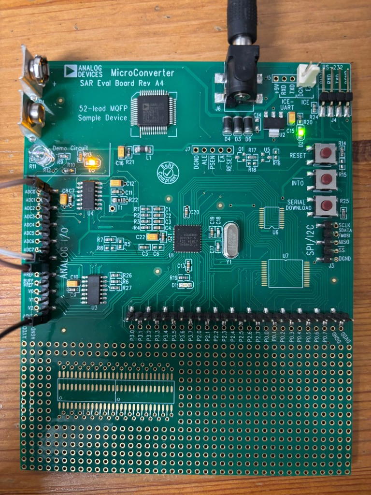
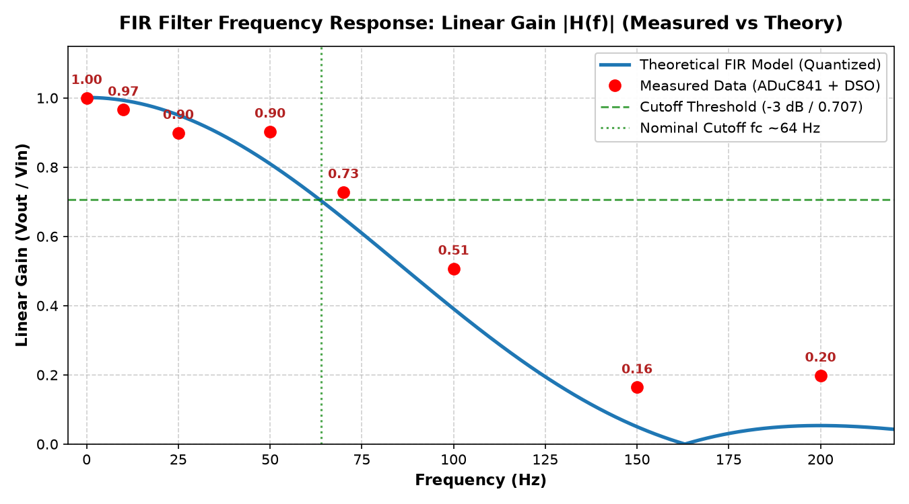
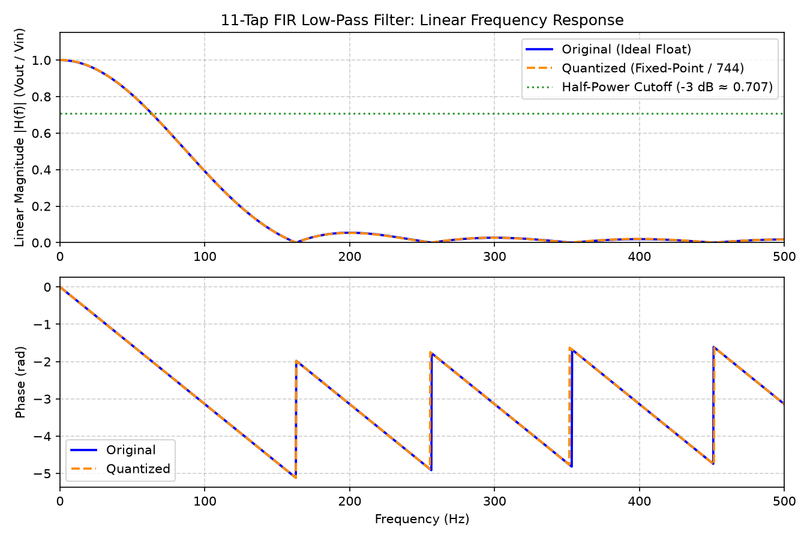
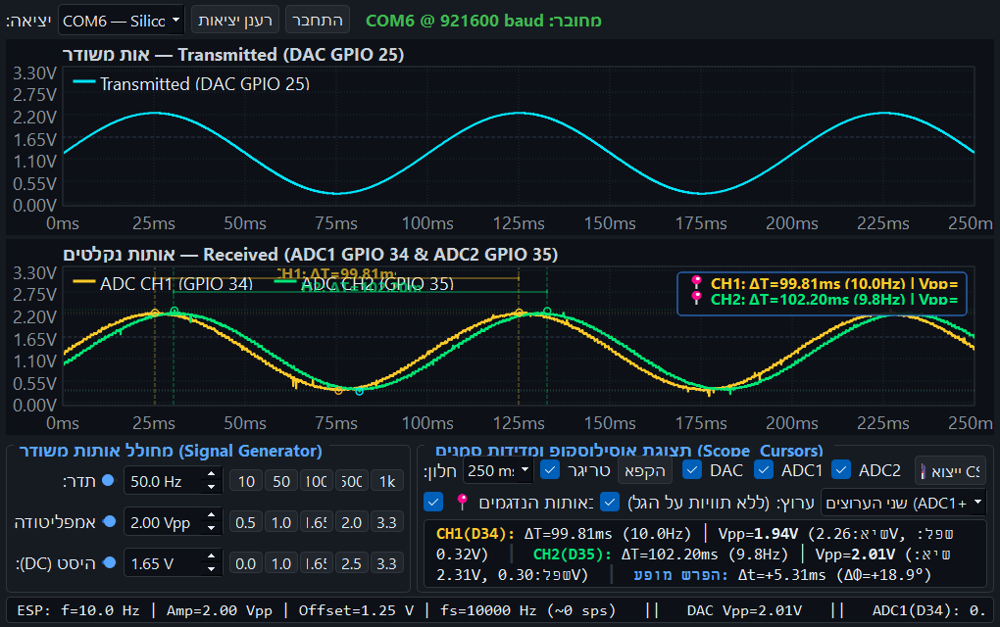
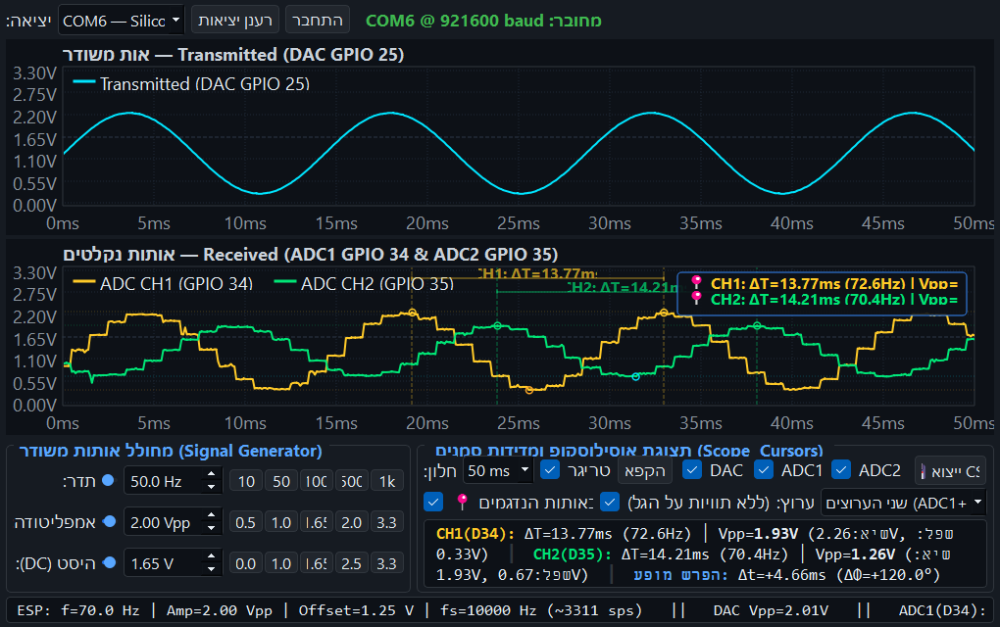
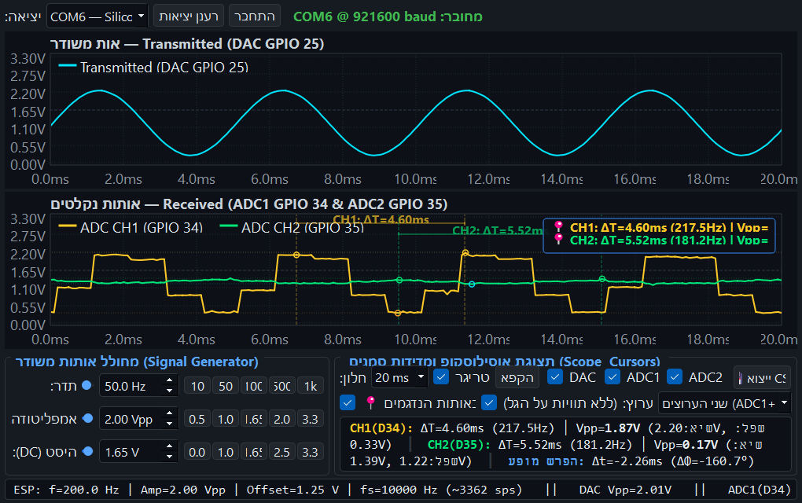

# Real-Time Digital FIR Filter on ADuC841 (8051 Architecture)

[-orange.svg)](https://www.analog.com/en/products/aduc841.html)
[](#-system-architecture)
[](#-mathematical-model--fixed-point-dsp)
[](#-experimental-verification)
[](LICENSE)

**[English](README.md) • [עברית (Hebrew)](README.he.md)**

A bare-metal embedded C implementation of a **Real-Time 11-Tap Finite Impulse Response (FIR) Low-Pass Filter** running on an **Analog Devices ADuC841** microcontroller (pipelined single-cycle 8051 core).

The system continuously acquires analog input data via a hardware timer trigger ($F_s = 1000\text{ Hz}$), executes fixed-point convolution using an $O(1)$ circular buffer residing in fast internal RAM (`idata`), and drives dual on-chip 12-bit DACs to benchmark the raw input against the filtered output in real time on an oscilloscope.

<div align="center">
  
  <p><em>Hardware Setup: Analog Devices ADuC841 MicroConverter SAR Evaluation Board (Rev A4) running the real-time FIR DSP firmware</em></p>
</div>

---

## 🚀 Key Engineering Highlights

- **Deterministic Hard Real-Time Timing:** Hardware Timer 2 in 16-bit auto-reload mode (`RCAP2 = 0xD4CC`) directly triggers the SAR ADC conversion at exactly $1.0\text{ kHz}$ ($T_s = 1.0\text{ ms}$), eliminating software trigger jitter.
- **Ultra-Lean ISR Architecture:** ADC conversion completion triggers a dedicated ISR (`interrupt 6`) that only captures the conversion register (`ADCDATA`) and asserts an event flag, deferring math to the foreground loop for deterministic interrupt latency.
- **Micro-Optimized Memory Placement:**
  - **Circular Buffer:** Allocated explicitly in 8051 **`idata`** (fast indirectly-addressed internal RAM) to avoid the cycle penalty of external `xdata`.
  - **Filter Coefficients:** Stored in program memory (**`code`**) as `signed char` constants, conserving scarce data RAM.
- **Fixed-Point DSP Arithmetic:** Normalized with an integer scaling factor (`SCALING_FACTOR = 744`), avoiding floating-point emulation overhead on an 8-bit core.
- **Dual-DAC Signal Reconstruction:**
  - **DAC0:** Pass-through of raw input sample (synchronous reference signal).
  - **DAC1:** Real-time filtered output with underflow clamping protection (`if (filtered < 0) filtered = 0;`).
- **End-to-End Hardware Characterization:** Validated across $0\text{ Hz} - 200\text{ Hz}$ using a dual-channel 10 kSPS data acquisition setup with live oscilloscope capture.

---

## 📐 System Architecture

### Processing Pipeline

```mermaid
flowchart LR
    A["Analog Input<br>2.00 Vpp, Offset 1.25V"] -->|Timer 2 Trigger| B["12-bit SAR ADC<br>Fs = 1.0 kHz"]
    B -->|ADC ISR| C["Circular Buffer<br>(idata RAM)"]
    C -->|Convolution Σ(h·x)| D["Fixed-Point FIR Engine<br>11 Taps, Scale 744"]
    B -->|Pass-Through| E["DAC0: Raw Input<br>(Channel 1 - Yellow)"]
    D -->|Clamping Logic| F["DAC1: Filtered Signal<br>(Channel 2 - Green)"]
    E --> G["Dual-Channel Scope / DSO"]
    F --> G
```

### Mathematical Model

The filter implements an 11-tap symmetric linear-phase FIR difference equation:

$$y[n] = \frac{1}{\text{SCALING\_FACTOR}} \sum_{m=0}^{10} h[m] \cdot x[n-m]$$

- **Coefficients ($h[m]$):** `{0, 30, 64, 96, 119, 127, 119, 96, 64, 30, 0}`
- **Normalization:** $\sum h[m] = 745 \approx 744$ (`SCALING_FACTOR = 744`), ensuring unity DC gain ($0\text{ dB}$).
- **Linear Phase Delay:** Constant group delay $\tau = \frac{N-1}{2} \cdot T_s = 5 \times 1.0\text{ ms} = 5.0\text{ ms}$.
- **Cutoff Frequency:** Theoretical half-power point $f_{-3\text{dB}} \approx 63.6\text{ Hz}$.

---

## 🔬 Experimental Verification

### Frequency Response & Hardware Verification

The physical hardware response closely matches the theoretical model across all operational regimes ($0-200\text{ Hz}$):

| Hardware Measurements vs Theory (DSO Verification) | Quantization Analysis (Float vs Fixed-Point) |
| :---: | :---: |
|  |  |
| **Physical oscilloscope measurements (red markers)** closely track the theoretical model across all frequencies. | **Fixed-point quantization (`SCALING_FACTOR = 744`)** maintains exact half-power cutoff ($0.707$) and linear phase. |

---

### Key Oscilloscope Captures

The following captures demonstrate the three operational regimes of the filter:

| Passband (10 Hz) | Cutoff Region (70 Hz) | Deep Stopband (200 Hz) |
| :---: | :---: | :---: |
|  |  |  |
| **Gain: -0.3 dB** ($0.97\times$)<br>Full amplitude transmission<br>Linear group delay $\tau \approx 5.0\text{ ms}$ | **Gain: -2.8 dB** ($0.73\times$)<br>Near half-power point ($f_c \approx 64\text{ Hz}$)<br>$-90^\circ$ phase transition | **Gain: -14.1 dB** ($0.20\times$)<br>Deep high-frequency suppression<br>Residual noise floor rejection |

> **Channel Legend:**  
> 🟡 **CH1 (Yellow):** Raw input pass-through via `DAC0`  
> 🟢 **CH2 (Green):** Real-time FIR filtered output via `DAC1`

---

### Compact Performance Summary

| Frequency | Input $V_{pp}$ (CH1) | Output $V_{pp}$ (CH2) | Measured Gain | Theoretical Gain | Filter Regime |
| :---: | :---: | :---: | :---: | :---: | :--- |
| **0 Hz (DC)** | $1.25\text{ V}$ | $1.25\text{ V}$ | **0.0 dB** | $0.0\text{ dB}$ | Exact DC baseline preservation |
| **10 Hz** | $2.15\text{ V}$ | $2.08\text{ V}$ | **-0.3 dB** | $-0.1\text{ dB}$ | Flat passband, minimal loss |
| **50 Hz** | $1.99\text{ V}$ | $1.80\text{ V}$ | **-0.9 dB** | $-1.8\text{ dB}$ | Cutoff knee, onset of roll-off |
| **70 Hz** | $2.10\text{ V}$ | $1.53\text{ V}$ | **-2.8 dB** | **-3.0 dB** | **-3 dB cutoff point** ($f_c \approx 64\text{ Hz}$) |
| **100 Hz** | $1.95\text{ V}$ | $0.99\text{ V}$ | **-5.9 dB** | $-8.2\text{ dB}$ | Transition band, 50% amplitude reduction |
| **200 Hz** | $1.90\text{ V}$ | $0.38\text{ V}$ | **-14.1 dB** | $-25.4\text{ dB}$ | Deep stopband rejection |

*For complete telemetry across all 8 frequencies and oscilloscope screenshots, see the [Full Verification Report](docs/FIR_FILTER_VERIFICATION_REPORT.md) and [Telemetry Data](docs/sweep_measurements.json).*

---

## 📁 Repository Structure

```text
├── project.uvproj        # Keil µVision project file (ready to build)
├── src/
│   ├── lab7_main.c          # Application entry point, main loop & DSP pipeline
│   ├── circular_buffer.c    # O(1) circular buffer implementation in idata RAM
│   ├── filter_taps.c        # 11-tap FIR coefficient array in code memory
│   ├── filter_taps.h        # Filter parameters & scaling definitions
│   ├── peripherals.c        # Timer 2, SAR ADC, Dual-DAC init & ADC ISR
│   └── peripherals.h        # SFR declarations, buffer struct & API prototypes
├── scripts/
│   └── fir_design.py        # Python script for coefficient generation & Bode modeling
├── docs/
│   ├── images/              # Oscilloscope captures and Bode plot response curves
│   ├── FIR_FILTER_VERIFICATION_REPORT.md # In-depth technical verification report
│   └── sweep_measurements.json          # Experimental sweep dataset
├── LICENSE                  # MIT License
├── README.md                # English Documentation
└── README.he.md             # Hebrew Documentation (עברית)
```

---

## 🛠️ Hardware & Toolchain Specifications

| Parameter | Specification |
| :--- | :--- |
| **Microcontroller** | Analog Devices ADuC841 (8052 Core, 16.78 MHz) |
| **Architecture** | Pipelined single-cycle 8051, Harvard architecture |
| **ADC** | On-chip 12-bit SAR ADC, hardware triggered by Timer 2 |
| **DAC** | Dual 12-bit voltage-output DACs (`DAC0` raw, `DAC1` filtered) |
| **Compiler / IDE** | Keil C51 Compiler / µVision IDE |
| **Memory Model** | Small model with explicit `idata` allocation for the circular buffer |
| **Test Equipment** | ESP32-based 10 kSPS dual-channel DSO with Python/PyQt5 GUI |

---

## 🚀 Building & Flashing

1. **Open Keil µVision Project:**
   - Launch Keil µVision and open `project.uvproj` directly from the repository root.
   - The target device (`ADuC841`), source groups (`.\src\*.c`), include paths, and hex output are preconfigured.
2. **Build:**
   - Compile and link (`F7` or *Build Target*). Keil produces `Objects\aduc841_fir_filter.hex` with 0 errors and 0 warnings.
3. **Flashing via WSD:**
   - Connect the ADuC841 evaluation board to PC via RS-232 / UART.
   - Put device into download mode (hold `DOWNLOAD` button while pressing `RESET`).
   - Launch Analog Devices **WSD (Windows Serial Downloader)**, select COM port, choose `.hex` file, and click **Download**.
4. **Operation & Verification:**
   - Connect the analog signal generator to the ADC input pin.
   - Probe `DAC0` (pin 12 / DAC0 output) and `DAC1` (pin 13 / DAC1 output) on an oscilloscope.
